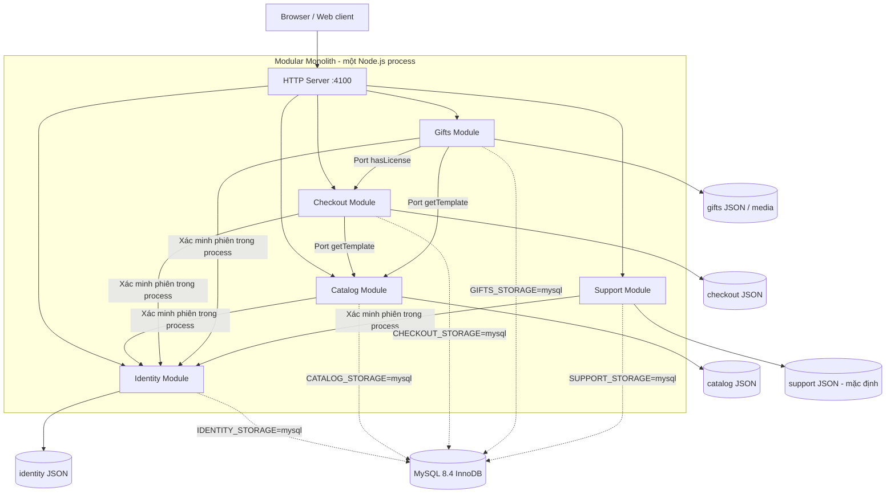

# Kiến trúc đang chạy — Momevia Modular Monolith (v1.0.0)

**Trạng thái:** Một Node.js backend process; mặc định lưu JSON để giữ dữ liệu cũ. MySQL 8.4 có adapter tùy chọn cho **Support (v0.8), Identity/Catalog (v0.9), Gifts/Checkout demo (v1.0)** qua biến `.env`. **Chưa có thanh toán thật, object storage hoặc production readiness.**



## Entry points

- `npm run dev` và `npm start` → `dev.mjs` → `src/bootstrap/start.mjs` → `src/server/app.mjs`, mặc định một HTTP listener `127.0.0.1:4100`.
- `PORT`/`HOST` hỗ trợ thay đổi điểm lắng nghe. Khi triển khai qua reverse proxy phải cấu hình `PUBLIC_BASE_URL`, HTTPS và trust boundary đúng.
- `npm run dev:legacy` khởi động topology 6 process **chỉ để kiểm tra tương thích**. Các entrypoint `services/*/server.mjs` và `src/gateway/*` giữ cho trường hợp này, không nên vận hành hai topology đồng thời trên cùng dữ liệu JSON.

## Composition root và ranh giới module

`src/server/app.mjs` tạo từng module rồi inject phụ thuộc theo hướng một chiều:

1. Identity cung cấp phương thức truy xuất phiên hiện hành (`SessionStore.find`). Các route có bảo vệ nhận `resolveUser` từ composition root.
2. Catalog cung cấp `getTemplate` cho Checkout và Gifts; không còn gọi HTTP `4102` trong runtime mới.
3. Checkout cung cấp `hasLicense` cho Gifts; không còn gọi HTTP `4104` trong runtime mới.
4. Các lớp `Service`, `Repository` và API contract của frontend vẫn giữ nguyên.

Factory `createApp` của Identity, Catalog, Checkout, Gifts và `createHttpApp` trả Promise; entrypoint phải `await` để hoàn tất việc tạo tài khoản mẫu từ `TEST_ACCOUNT_*` trước khi mở HTTP listener. Tài khoản nằm trong `users.json` hoặc bảng `users` của MySQL theo `IDENTITY_STORAGE`, giữ `passwordHash` và metadata `testAccount.source = "env"`. Xem [cấu hình tài khoản mẫu](../README.md#tài-khoản-mẫu-qua-env).

`src/shared/http.mjs` có `Router.handle` để ghép nhiều router vào một HTTP server. Server gốc nhận đúng tiền tố `/api/auth`, `/api/catalog`, `/api/checkout`, `/api/gifts`, `/api/support`. Server chỉ chấp nhận các HTTP method cũ và tiếp tục chặn namespace `/internal`, request POST cross-origin và các forwarded headers do client tự khai.

## Bảo mật và nhất quán

- Mỗi request cần đăng nhập đều truy vấn `SessionStore.find` trong tiến trình để kiểm tra chữ ký, JTI đã thu hồi, hạn sử dụng và role **mới nhất**, thay vì tin role nằm sẵn trong JWT.
- Không còn HTTP session introspection nội bộ ở runtime mặc định, nhưng legacy adapter vẫn tồn tại. Điều này không làm mất chức năng logout/revoke.
- Hiệu năng và đa instance **chưa được benchmark**. Mỗi module có thể lưu JSON hoặc MySQL theo cờ riêng; cần import và đối chiếu trước khi chuyển. v1.0 dùng transaction MySQL cho đơn demo + quyền sử dụng và ghi reply + tăng bộ đếm, nhưng **chưa có transaction xuyên module/real-payment settlement**. Ảnh quà vẫn ở local filesystem và cần object storage trước production.
- Không chạy server legacy và modular cùng lúc trên cùng tập file dữ liệu.

## Kiểm thử và tiếp tục phát triển

```bash
npm ci
npm run build
npm run check
npm test
npm run test:architecture
```

`test:architecture` chạy **một backend process** trên port ngẫu nhiên với dữ liệu riêng trong thư mục tạm, kiểm tra API, phân quyền, phiên và nhiều luồng nghiệp vụ. `test:architecture:legacy` dành cho topology cũ. Browser tests dùng `npm run test:browser` khi Playwright/browser đã được cài.

**Bước tiếp theo:** Chạy migration 004 và kiểm thử end-to-end MySQL cho Gifts/Checkout tại máy local (xem [hướng dẫn v1.0](MYSQL_V10_GIFTS_CHECKOUT.md)). Sau đó xây payment gateway/webhook đã xác thực, creator payout ledger thực, object storage và background worker; CI unit test không thể thay thế kiểm thử tích hợp DB thật.
