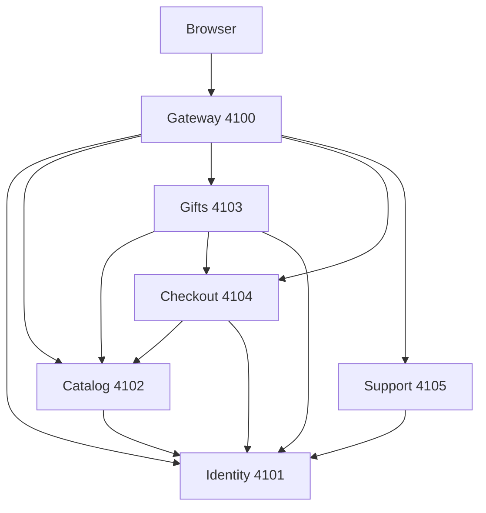

# Kiến trúc đang chạy — Momevia MVP

## Trạng thái sau sắp xếp mã

Mã đã chia module và lớp trách nhiệm; mô hình triển khai vẫn là Gateway và năm service Node chạy thành sáu process, cổng 4100–4105, bind loopback. Chưa chuyển sang modular monolith và chưa thay JSON bằng DB server.

Các mũi tên về Identity là kiểm tra phiên nội bộ. HTTP nội bộ vẫn tồn tại; việc chuyển class sang module không tự bỏ phụ thuộc runtime đó.

## Tổ chức nguồn

- `src/bootstrap/start.mjs`: khởi động các process.
- `src/gateway/`: dispatch request, proxy và phục vụ static assets.
- `src/modules/{identity,catalog,checkout,gifts,support}/`: mỗi nhóm nghiệp vụ có app composition, route, service và repository riêng.
- `src/shared/`: config, HTTP, session verification, limiter, IP/proxy và JSON storage.
- `web/js/app/main.js`: điều hướng và sự kiện; `pages`, `ui`, `features`, `core` chứa các phần tách riêng.
- `services/*/server.mjs`, `dev.mjs`, `gateway.mjs`: entrypoint tương thích, không chứa nghiệp vụ.

Luồng phụ thuộc: **server → app → routes → service → repository/client**. App lắp ráp các phụ thuộc; service nhận repository/client qua constructor. HTTP route không trực tiếp đọc/ghi JSON. Adapter media của Gifts sở hữu đọc/ghi file ảnh; route chỉ stream response.

Xem [cây thư mục và hướng dẫn thêm logic](PROJECT_STRUCTURE.md).

## Quyền, phiên và dữ liệu

- Một tài khoản có một role. Chỉ Admin đổi role qua API; Sender/Creator không tự nâng quyền. Không tự hạ role của dữ liệu đã có.
- Identity sở hữu users và sessions JSON. Mỗi API cần đăng nhập xác minh chữ ký rồi hỏi Identity về phiên/role hiện tại. Logout thu hồi phiên hiện tại, tồn tại qua restart Identity; lỗi kiểm tra phiên trả 503.
- Gateway chặn namespace nội bộ, bỏ header khóa dịch vụ do client gửi và thiết lập IP từ socket. Nếu thêm reverse proxy, cần xác định lại trust chain.
- Limiter theo process dùng bộ nhớ shard hữu hạn, không dùng LRU xóa quota còn hiệu lực. Chưa có rate limit phân tán hoặc WAF.
- Dữ liệu vẫn ở `services/*/data/`; `src/shared/paths.mjs` giữ đường dẫn cũ. I/O JSON đồng bộ; mỗi file chỉ được có một writer. Không chạy seed cùng ứng dụng đang ghi dữ liệu.
- Ảnh mới qua sharp, giới hạn bytes/pixel và bỏ metadata; không sửa ảnh cũ. QR được tạo tại trình duyệt.
- Quà/reply/order/role/slug/password hash và giấy phép cũ không được migrate trong đợt refactor.

## Giới hạn và hướng tiếp theo

Chưa có database ACID, transaction nhiều file, nhiều writer, HA, service discovery, thanh toán thật hoặc đo tải production. Tách process hiện tại phục vụ MVP/nghiên cứu, chưa phải một hệ microservices vận hành đầy đủ.

**Không bắt buộc dùng microservices.** Đề xuất cho giai đoạn tiếp theo là modular monolith; lựa chọn DB là quyết định riêng. Xem [so sánh và lộ trình](ARCHITECTURE_OPTIONS.md). Chưa triển khai phương án đó trong đợt này.

Kiểm thử, phạm vi bảo mật và trạng thái CI nằm tại [CODE_REVIEW_ARCHITECTURE.md](CODE_REVIEW_ARCHITECTURE.md) và [CI_RELEASE.md](CI_RELEASE.md).
