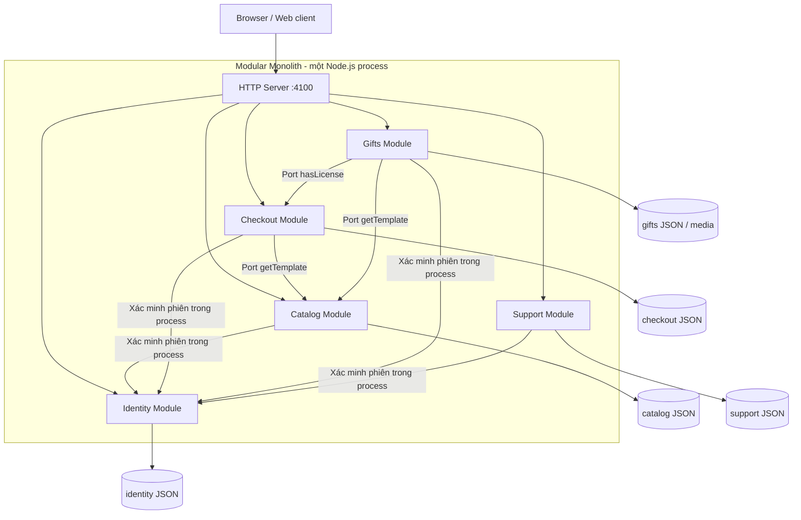

# Kiến trúc đang chạy — Momevia Modular Monolith (v0.6.0)

**Trạng thái:** Đã chuyển runtime mặc định từ 6 process sang **1 backend process**. Đây là bước thay đổi topology, **chưa phải migration PostgreSQL hoặc triển khai production**.



## Entry points

- `npm run dev` và `npm start` → `dev.mjs` → `src/bootstrap/start.mjs` → `src/server/app.mjs`, mặc định một HTTP listener `127.0.0.1:4100`.
- `PORT`/`HOST` hỗ trợ thay đổi điểm lắng nghe. Khi triển khai qua reverse proxy phải cấu hình `PUBLIC_BASE_URL`, HTTPS và trust boundary đúng.
- `npm run dev:legacy` khởi động topology 6 process **chỉ để kiểm tra tương thích**. Các entrypoint `services/*/server.mjs` và `src/gateway/*` giữ cho trường hợp này, không nên vận hành hai topology đồng thời trên cùng dữ liệu JSON.

## Composition root và ranh giới module

`src/server/app.mjs` tạo từng module rồi inject phụ thuộc theo hướng một chiều:

1. Identity cung cấp phương thức truy xuất phiên hiện hành (`SessionStore.find`). Các route có bảo vệ nhận `resolveUser` từ composition root.
2. Catalog cung cấp `getTemplate` cho Checkout và Gifts; không còn gọi HTTP `4102` trong runtime mới.
3. Checkout cung cấp `hasLicense` cho Gifts; không còn gọi HTTP `4104` trong runtime mới.
4. Các lớp `Service`, `Repository` và API contract của frontend vẫn giữ nguyên.

`src/shared/http.mjs` có `Router.handle` để ghép nhiều router vào một HTTP server. Server gốc nhận đúng tiền tố `/api/auth`, `/api/catalog`, `/api/checkout`, `/api/gifts`, `/api/support`. Server chỉ chấp nhận các HTTP method cũ và tiếp tục chặn namespace `/internal`, request POST cross-origin và các forwarded headers do client tự khai.

## Bảo mật và nhất quán

- Mỗi request cần đăng nhập đều truy vấn `SessionStore.find` trong tiến trình để kiểm tra chữ ký, JTI đã thu hồi, hạn sử dụng và role **mới nhất**, thay vì tin role nằm sẵn trong JWT.
- Không còn HTTP session introspection nội bộ ở runtime mặc định, nhưng legacy adapter vẫn tồn tại. Điều này không làm mất chức năng logout/revoke.
- Tốc độ tăng, khả năng chịu tải và độ an toàn dữ liệu **chưa được benchmark**. Dữ liệu vẫn lưu ở `services/*/data/` với JSON đồng bộ; chưa có transaction nhiều file hoặc nhiều instance an toàn.
- Không chạy server legacy và modular cùng lúc trên cùng tập file dữ liệu.

## Kiểm thử và tiếp tục phát triển

```bash
npm ci
npm run build
npm run check
npm test
npm run test:architecture
```

`test:architecture` chạy **một backend process** trên port ngẫu nhiên với dữ liệu riêng trong thư mục tạm, kiểm tra API, phân quyền, phiên và nhiều luồng nghiệp vụ. `test:architecture:legacy` dành cho topology cũ. Browser tests dùng `npm run test:browser` khi Playwright/browser đã được cài.

**Bước tiếp theo:** Migration dữ liệu JSON sang PostgreSQL với migration có rollback/backup, transaction cho đơn hàng và quyền sử dụng; sau đó mới bổ sung thanh toán thật, webhook idempotent và worker gửi lời mời.
