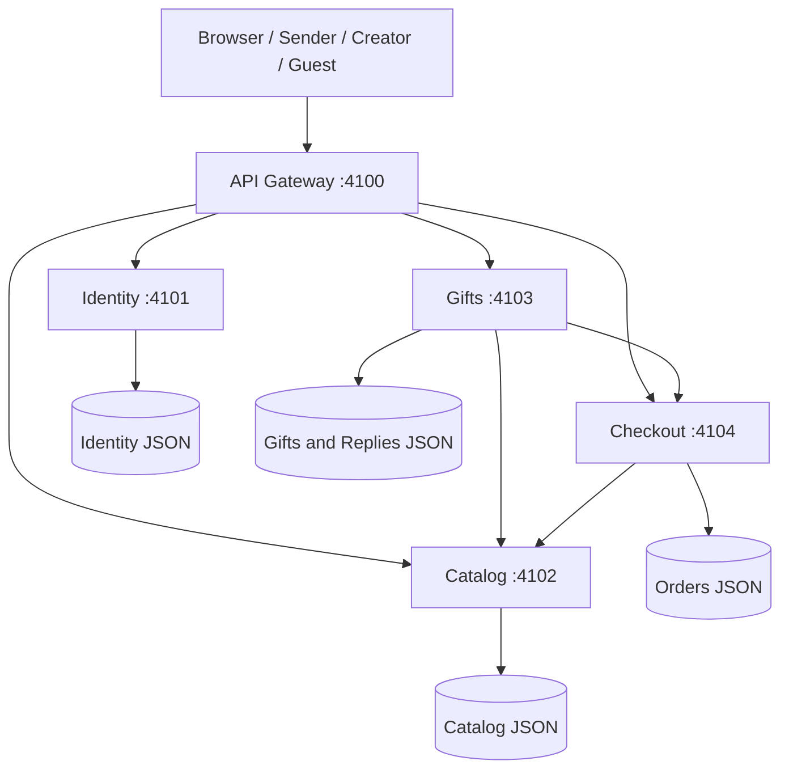

# Kiến trúc kỹ thuật — Momevia MVP

## Phân rã microservices

- **Gateway:** reverse proxy, static assets và kiểm tra origin cơ bản.
- **Identity:** OAuth Google/Zalo, login demo, quản lý người dùng, JWT session.
- **Catalog:** thư viện template, Creator, kiểm duyệt.
- **Checkout:** mua mẫu demo, phân bổ hoa hồng, chứng thực quyền mẫu.
- **Gifts:** lưu thiệp, ảnh, phát hành link, phản hồi.
- **Shared:** lớp `Router`, `JsonRepository`, `HttpError`, `IdentityService` và bảo mật chung; chia sẻ thư viện dùng chung ở giai đoạn MVP nhưng không dùng chung tệp dữ liệu.

## Lý do sử dụng OOP

- Mỗi dịch vụ đóng gói xử lý chính trong class tương ứng (`IdentityService`, `CatalogService`, `CheckoutService`, `GiftService`).
- Lớp `JsonRepository` chịu trách nhiệm truy xuất và lưu dữ liệu.
- `Router` điều phối endpoint độc lập với lớp nghiệp vụ.
- Lớp HTTP/security cung cấp cơ chế lỗi, xác thực, kiểm soát dữ liệu chung.

## Hệ thống production mục tiêu (chưa triển khai)

- PostgreSQL riêng cho từng microservice; migration và transaction ACID.
- Message broker/event bus để đồng bộ `PaymentSucceeded`, `LicenseGranted`, `GiftPublished`.
- Redis/cache/rate limit phân tán, idempotency keys cho payment webhook.
- S3-compatible storage cho media với presigned URLs và chính sách bảo vệ PII.
- API Gateway HTTPS, WAF, MFA Admin, logging/monitoring và backups.
- Infrastructure-as-Code, tự động kiểm thử/trải nghiệm mobile, CI/CD.
- Phân tích quyền pháp lý, bản quyền nội dung và trách nhiệm merchant of record.

**Chú ý:** Dịch vụ đang chạy độc lập trong các tiến trình nhưng chưa có HA, scaling, service discovery hay giải quyết distributed transactions. Đây là MVP microservices để phát triển và nghiên cứu kiến trúc, không phải kiến trúc vận hành thương mại hoàn chỉnh.

## Phiên bản 0.3 — Favorites và Support

- `Catalog Service` sở hữu danh sách yêu thích theo `userId` qua `/favorites`, yêu cầu cookie phiên hợp lệ.
- `Support Service` chạy cổng 4105, ghi nhận phiếu liên hệ với mã tra cứu; chỉ tài khoản Admin được xem toàn bộ.
- `API Gateway` chuyển tiếp `/api/support/*` đến cổng 4105.
- Mỗi dịch vụ giữ data JSON riêng cho môi trường phát triển, không phải hạ tầng production.
