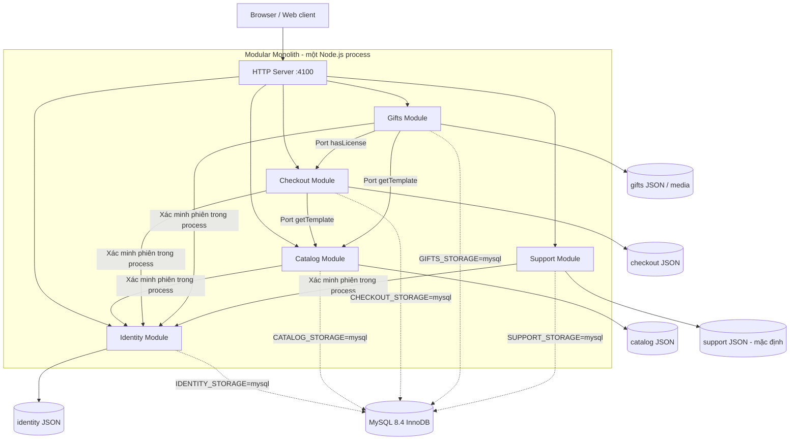

# Kiến trúc đang chạy — Momevia v1.1 + Sender canvas

**Trạng thái source:** Một Node.js backend process, các service/repository async. JSON mặc định; MySQL 8.4 cho Identity/Catalog/Gifts/Checkout/Support/Designs. Payment v1.1 có provider/webhook/settlement/receipt foundation, mặc định tắt. Canvas Sender có draft CAS/assets/publication UnitOfWork; merchant live, object storage và multi-instance production chưa nghiệm thu.



## Entry points

- `npm run dev` và `npm start` → `dev.mjs` → `src/bootstrap/start.mjs` → `src/server/app.mjs`, mặc định một HTTP listener `127.0.0.1:4100`.
- `PORT`/`HOST` hỗ trợ thay đổi điểm lắng nghe. Khi triển khai qua reverse proxy phải cấu hình `PUBLIC_BASE_URL`, HTTPS và trust boundary đúng.
- `npm run dev:legacy` khởi động topology 6 process **chỉ để kiểm tra tương thích**. Các entrypoint `services/*/server.mjs` và `src/gateway/*` giữ cho trường hợp này, không nên vận hành hai topology đồng thời trên cùng dữ liệu JSON.

## Composition root và ranh giới module

`src/server/app.mjs` tạo từng module rồi inject phụ thuộc theo hướng một chiều:

1. Identity cung cấp phương thức truy xuất phiên hiện hành (`SessionStore.find`). Các route có bảo vệ nhận `resolveUser` từ composition root.
2. Catalog cung cấp `getTemplate` cho Checkout và Gifts; không còn gọi HTTP `4102` trong runtime mới.
3. Checkout cung cấp `hasLicense` cho Gifts; không còn gọi HTTP `4104` trong runtime mới.
4. Các lớp `Service`, `Repository` và API contract của frontend vẫn giữ nguyên.

Factory `createApp` của Identity, Catalog, Checkout, Gifts và `createHttpApp` trả Promise; entrypoint phải `await` để hoàn tất việc tạo tài khoản mẫu từ `TEST_ACCOUNT_*` trước khi mở HTTP listener. Tài khoản nằm trong `users.json` hoặc bảng `users` của MySQL theo `IDENTITY_STORAGE`, giữ `passwordHash` và metadata `testAccount.source = "env"`. Xem [cấu hình tài khoản mẫu](../README.md#tài-khoản-mẫu-qua-env).

`src/shared/http.mjs` có `Router.handle` để ghép nhiều router vào một HTTP server. Server gốc nhận đúng tiền tố `/api/auth`, `/api/catalog`, `/api/checkout`, `/api/gifts`, `/api/support`. Server chỉ chấp nhận các HTTP method cũ và tiếp tục chặn namespace `/internal`, request POST cross-origin và các forwarded headers do client tự khai.

## Bảo mật và nhất quán

- Mỗi request cần đăng nhập đều truy vấn `SessionStore.find` trong tiến trình để kiểm tra chữ ký, JTI đã thu hồi, hạn sử dụng và role **mới nhất**, thay vì tin role nằm sẵn trong JWT.
- Không còn HTTP session introspection nội bộ ở runtime mặc định, nhưng legacy adapter vẫn tồn tại. Điều này không làm mất chức năng logout/revoke.
- Hiệu năng chỉ đo fixture ghi tại [QA canvas](CANVAS_QA_REPORT.md), chưa là benchmark production/đa instance. Các mixed mode legacy còn nguyên; canvas publication yêu cầu profile đồng nhất. MySQL UnitOfWork dùng cùng connection cho design/version/gift/pins/key và kiểm entitlement. Payment settlement v1.1 ghi order/right/receipt cùng transaction. DB và filesystem vẫn cần backup/recovery phối hợp.
- Không chạy server legacy và modular cùng lúc trên cùng tập file dữ liệu.

## Kiểm thử và tiếp tục phát triển

```bash
npm ci
npm run build
npm run check
npm test
npm run test:architecture
```

`test:architecture` chạy **một backend process** trên port ngẫu nhiên với dữ liệu riêng trong thư mục tạm, kiểm tra API, phân quyền, phiên và nhiều luồng nghiệp vụ. `test:architecture:legacy` dành cho topology cũ. Browser tests dùng `npm run test:browser` khi Playwright/browser đã được cài.

**Vận hành tiếp theo:** Chỉ áp dụng migration mới lên dữ liệu thật sau backup/restore và phê duyệt riêng. Canvas QA đã chạy MySQL 8.4 cô lập và provider inject; không biến kết quả đó thành nghiệm thu merchant. Payout, đối soát, object storage và production rollout là công việc riêng.

## Designs và publication

`src/modules/designs` sở hữu private drafts, create/save mutation ACK, asset metadata và checkout resume contexts; Gifts giữ public gift/reply/TTL. Composition root inject Catalog/Checkout qua port. `web/js/shared/canvas` là một nguồn schema/validator/registry/preset thuần cho Node và browser, được ship nguyên trong `web/`, không cần engine hoặc framework mới.

JSON lưu aggregate version 1 tại `services/designs/data/canvas.json`: một rename commit document+ACK hoặc version+gift+pins+publication result. Critical section theo đường dẫn trong một process; tmp chưa commit không được đọc. Snapshot self-contained, không dual-write sang gifts.json. Gifts adapter gộp canvas publications khi đọc mine/public/reply. Không chạy nhiều process chung JSON.

MySQL dùng migration 006 cộng thêm; giữ 001–005. UnitOfWork inject một MySqlClient/connection, khóa owner → publication key → design → template/entitlement/order → assets theo ID. Quyền revoke/publish do thứ tự nhận khóa entitlement quyết định; snapshot đã commit tiếp tục đọc đến TTL. Không gọi provider/upload/decode trong transaction. Checksum ảnh được xác lập khi re-encode, public media kiểm pin+TTL; chưa bật destructive GC.

Editor dynamic import trên `/create/:id` và `/design/:id`; player public không import editor. Router có generation/dispose/abort, bảo vệ draft với navigate/popstate/beforeunload. Runtime dùng chung preview/public, preview mô phỏng reply. Rollback writer giữ `CANVAS_READ_ENABLED=true`; không rollback binary không hiểu snapshot. Hướng dẫn backup và giới hạn nằm ở [CANVAS_SENDER_GUIDE](CANVAS_SENDER_GUIDE.md).
