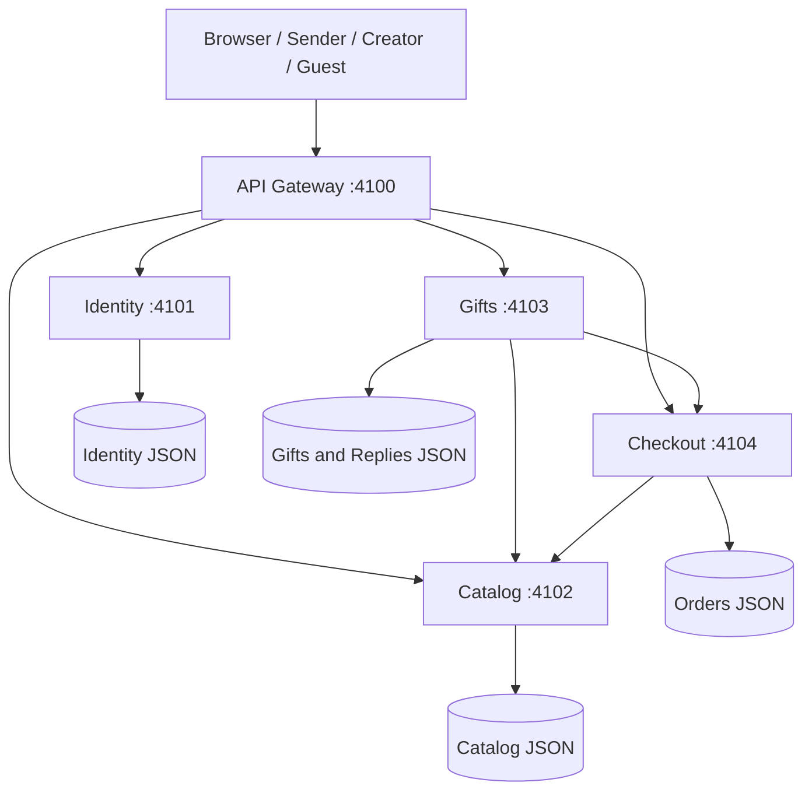

# Kiến trúc kỹ thuật — Momevia MVP

## Phân rã microservices

- **Gateway:** reverse proxy, static assets và kiểm tra origin cơ bản.
- **Identity:** OAuth Google/Zalo, login demo, quản lý người dùng, JWT session.
- **Catalog:** thư viện template, Creator, kiểm duyệt.
- **Checkout:** mua mẫu demo, phân bổ hoa hồng, chứng thực quyền mẫu.
- **Gifts:** lưu thiệp, ảnh, phát hành link, phản hồi.
- **Shared:** lớp `Router`, `JsonRepository`, `HttpError`, `IdentityService` và bảo mật chung; chia sẻ thư viện dùng chung ở giai đoạn MVP nhưng không dùng chung tệp dữ liệu.

## Lý do sử dụng OOP

- Mỗi dịch vụ đóng gói xử lý chính trong class tương ứng (`IdentityService`, `CatalogService`, `CheckoutService`, `GiftService`).
- Lớp `JsonRepository` chịu trách nhiệm truy xuất và lưu dữ liệu.
- `Router` điều phối endpoint độc lập với lớp nghiệp vụ.
- Lớp HTTP/security cung cấp cơ chế lỗi, xác thực, kiểm soát dữ liệu chung.

## Hệ thống production mục tiêu (chưa triển khai)

- PostgreSQL riêng cho từng microservice; migration và transaction ACID.
- Message broker/event bus để đồng bộ `PaymentSucceeded`, `LicenseGranted`, `GiftPublished`.
- Redis/cache/rate limit phân tán, idempotency keys cho payment webhook.
- S3-compatible storage cho media với presigned URLs và chính sách bảo vệ PII.
- API Gateway HTTPS, WAF, MFA Admin, logging/monitoring và backups.
- Infrastructure-as-Code, tự động kiểm thử/trải nghiệm mobile, CI/CD.
- Phân tích quyền pháp lý, bản quyền nội dung và trách nhiệm merchant of record.

**Chú ý:** Dịch vụ đang chạy độc lập trong các tiến trình nhưng chưa có HA, scaling, service discovery hay giải quyết distributed transactions. Đây là MVP microservices để phát triển và nghiên cứu kiến trúc, không phải kiến trúc vận hành thương mại hoàn chỉnh.

## Phiên bản 0.3 — Favorites và Support

- `Catalog Service` sở hữu danh sách yêu thích theo `userId` qua `/favorites`, yêu cầu cookie phiên hợp lệ.
- `Support Service` chạy cổng 4105, ghi nhận phiếu liên hệ với mã tra cứu; chỉ tài khoản Admin được xem toàn bộ.
- `API Gateway` chuyển tiếp `/api/support/*` đến cổng 4105.
- Mỗi dịch vụ giữ data JSON riêng cho môi trường phát triển, không phải hạ tầng production.

## Bản sửa kiến trúc và bảo mật 16/11/2026

- Một tài khoản lưu một role; chỉ Admin đổi role qua API quản trị. Chặn tự mở quyền Creator ở backend và bỏ thao tác tự nâng quyền trên giao diện. Kiểm tra role hiện tại, nên token Creator/Admin cũ không giữ đặc quyền sau khi bị hạ role. Không tự hạ role của tài khoản đã tồn tại.
- Identity sở hữu `sessions.json`; JWT mới có `jti`, mỗi phiên được ghi nhận trước khi cấp cookie. Các service xác minh chữ ký cục bộ rồi gọi `POST /internal/session` để kiểm tra phiên và role hiện tại. Logout xóa phiên hiện tại, có hiệu lực sau restart Identity. Không dùng cache phiên; nếu Identity lỗi, yêu cầu cần kiểm tra phiên trả `503`. Đây là phụ thuộc runtime mới, chưa có HA.
- Gateway chặn namespace nội bộ và thiết lập IP từ socket; service chỉ nhận header IP hợp lệ từ loopback. Mô hình này giả định Gateway truy cập trực tiếp từ client; khi thêm reverse proxy/hosting phải thiết kế lại trust chain để không gom mọi người dùng vào IP proxy.
- Rate limit theo process dùng shard hash có khóa, giữ tối đa 10.000 shard và không xóa quota còn hiệu lực. Va chạm có thể chia sẻ quota; quota tổng chủ động từ chối lưu lượng vượt sức chứa. Không hứa chống được DDoS hoặc đồng bộ nhiều instance.
- I/O JSON vẫn đồng bộ và mỗi service là writer duy nhất. Đoạn check+insert/update liên tục không có `await` không bị xen kẽ trong cùng process. Atomic rename bảo vệ một lần thay file, không tạo transaction giữa gifts/replies hay giải quyết nhiều writer. Không chạy seed cùng service đang hoạt động.
- Ảnh mới được encode lại bằng sharp, tối đa 2 MB và 16 triệu pixel, cạnh tối đa 8192 pixel; tối đa hai tác vụ xử lý ảnh cùng lúc. Chưa xử lý lại ảnh cũ.
- QR được tạo bằng module JavaScript cục bộ sau build; không gửi secret slug tới dịch vụ QR ngoài.
- Xem [báo cáo đối chiếu](CODE_REVIEW_ARCHITECTURE.md) và [CI/gói phát hành](CI_RELEASE.md) cho bằng chứng và các giới hạn còn lại.
