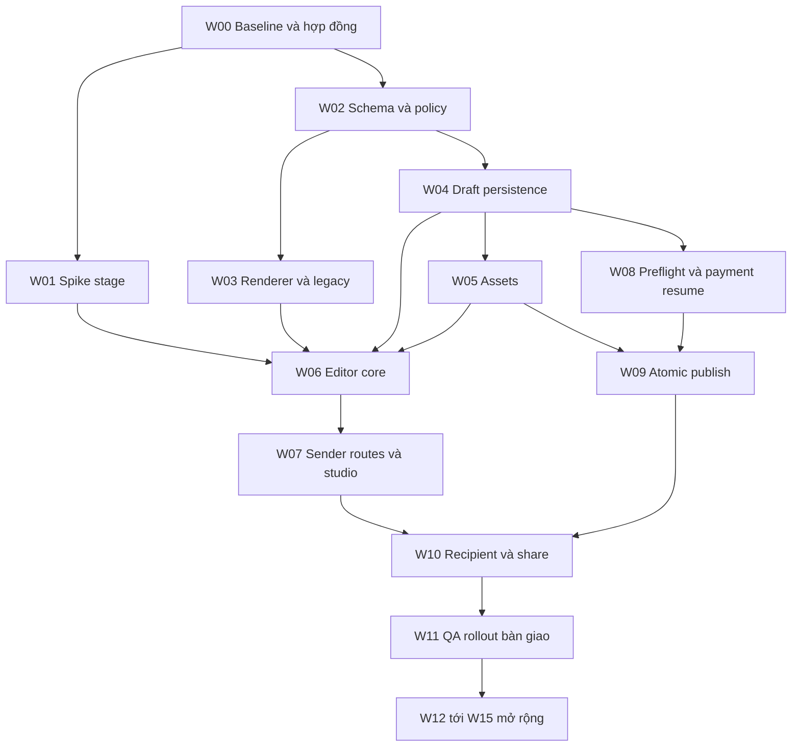

# Backlog triển khai canvas trên Momevia v1.1

Baseline rà soát `6c44bdb`, ngày 17/11/2026. Đây là kế hoạch công việc, không phải báo cáo các tính năng đã lập trình. Đọc cùng [kế hoạch tổng](CANVAS_DESIGN_PLAN.md), [editor spec](CANVAS_EDITOR_SPEC.md), [technical contract](CANVAS_TECHNICAL_CONTRACT.md) và [review v1.1](CANVAS_V11_REVIEW.md).

Ưu tiên đã được người dùng chọn: Sender cá nhân hóa và tự thiết kế cơ bản trước, Creator chuyên sâu sau. Mỗi gói việc có đầu ra chạy được, kiểm thử rồi sửa; sau ba gói liên tiếp phải có regression tích lũy. Không cần hỏi lại những quyết định kỹ thuật thông thường đã nằm trong phạm vi; chỉ dừng phần phụ thuộc quyết định sản phẩm chưa chốt hoặc hành động lên dữ liệu thật chưa được phép.

## 1. Trật tự và dependency

W02/W03 và thiết kế adapter W04 có thể phân công song song sau khi interface đã chốt. Không cho nhiều tác nhân cùng sửa `main.js`, `src/server/app.mjs` hoặc migration. Các file mới và interface cần có người sở hữu cụ thể trước khi chia việc.

## 2. Những gói việc bắt buộc cho lần giao đầu

| ID | Công việc và file tác động dự kiến | Phụ thuộc | Điều kiện hoàn thành |
| --- | --- | --- | --- |
| W00 | Kiểm Git/WIP/graph, source v1.1, capability; lập compatibility fixtures. Tài liệu và test fixtures | Không | Xác nhận source thực tế, không dùng nhận định PostgreSQL/demo-only cũ; ghi profile được hỗ trợ và gate riêng |
| W01 | Spike stage DOM/CSS, coordinate mapping, CSP, text IME, pointer/keyboard. Prototype cô lập trong local trước khi tích hợp | W00 | Drag đúng ở zoom 50/100/200%, Unicode/IME không lỗi, resize/crop giữ semantics, không hạ CSP |
| W02 | Schema/registry/policy/validator thuần dùng chung; document ID/source/revision/hash, action target validation | W00 | Round-trip ổn định, duplicate remap đúng, invalid/unknown types bị từ chối, server-owned provenance không bị ghi đè |
| W03 | `web/js/features/gift-runtime/*`, legacy adapter, preview side-effect adapter | W02 | Cùng fixture render preview/public đồng nhất; legacy 12 mẫu giữ hành vi; preview không gọi reply/payment thật |
| W04 | `src/modules/designs/{app,routes,service,repositories,...}`, JSON/MySQL adapters, composition/prefix; client save controller | W02 | Owner-only; create/get/list/save; CAS hai tab; retry lost ACK; snapshot/storage flags tách rõ; migration chỉ test ở DB cô lập |
| W05 | Asset metadata/repository/routes và editor asset client/library, bảo toàn `gifts/photo.mjs` | W04 | Upload→ready; thay ảnh lỗi giữ ảnh cũ; draft/private/published ACL; pin refs; GC không xóa asset quà còn hạn |
| W06 | Editor store/commands/history/stage/inspector/layer/scenes, `web/css/editor.css` | W01/03/04/05 | Đủ bộ element cơ bản; một gesture là một undo command; numeric/keyboard thay drag; save/persist thật |
| W07 | `pages/designer.js`, `/create`, `/design`, `/studio`, route lifecycle trong `main.js`, `index.html` live status | W06 | Blank và personalization chạy; không mất draft Back/Forward/reload; studio giữ quà/biên nhận/favorite; không tự nâng role |
| W08 | Preflight service/API, capability read, checkout context/resume, tách payment-result controller khi cần | W04/05; tích hợp UI sau W07 | Save ACK trước checkout; methods error khác empty; order nhiều draft không đổi nhầm; return không cấp quyền/publish |
| W09 | `PublicationUnitOfWork`, gifts from-design, projection DTO, request key/hash, design version/asset refs | W02/04/05/08 | JSON recovery và MySQL cùng connection được kiểm riêng; một key→một gift; blank FK hợp lệ; không giữ lock khi gọi provider |
| W10 | Recipient runtime, success link/QR, legacy fallback, expiry/reply, preview artifact | W03/07/09 | Recipient không login; snapshot không đổi theo draft; không tải editor; reply legacy đúng; QR mở đúng slug |
| W11 | QA đủ profile, backup/export/import readiness, feature flags, release docs và hướng dẫn sử dụng | W00–W10 | Mọi gate có bằng chứng; không bỏ MySQL gate rồi báo hoàn tất cả MySQL; có rollback giữ được reader/publications |

Tên thư mục mới là đề xuất; chọn vị trí shared schema sau khi kiểm static serving/build/release allowlist. Không nhân đôi validator browser/server rồi để chúng lệch nhau. Shared contract nên thuần, không kéo `node:fs`, secrets hay DB code vào browser.

## 3. Các gói mở rộng có điều kiện

| ID | Phạm vi | Điều kiện bắt đầu | Kiểm chứng chính |
| --- | --- | --- | --- |
| W12 | Audio/video/album/animation/particle/reveal từng nhóm | W11 ổn định, pipeline/license/media budget của từng loại đã có | Bị chặn autoplay/lỗi media vẫn đọc được; nút thay gesture; reduced motion; preview/public parity |
| W13 | Creator scene/layer/timeline/slot/variant/version, admin review snapshot | W11 và template version contract | Submit revision cố định; edit mới không đổi pending/approved; Sender chỉ chỉnh vùng được phép |
| W14 | Mẫu cá nhân tái sử dụng, chia sẻ miễn phí và cộng đồng | Chính sách visibility/remix/asset/demo data/moderation đã chốt | Copy không mang PII/reply; không truyền quyền premium; không đồng nhất giá 0 với private |
| W15 | Custom code/component packaging/cộng tác/3D | Đặc tả riêng và phê duyệt phạm vi | Origin/sandbox/bridge/network/resource isolation; không triển khai ngầm trong W06 |

Đợt đầu có thể lưu và nhân bản thiết kế riêng làm nội dung dùng lại. Thư viện template cá nhân có version, chia sẻ cộng đồng và bán mẫu là các capability bổ sung; label UI phải phản ánh đúng trạng thái triển khai, không đặt tab rỗng như tính năng đã có.

## 4. Bộ tiêu chí nghiệm thu định danh

| Case | Thiết lập và thao tác | Kết quả bắt buộc | Gate |
| --- | --- | --- | --- |
| C01 | Sender đăng nhập → blank → text Unicode, ảnh, phong bì → save → F5 | Nội dung/crop/scene order/IDs không đổi; owner đúng | Unit, API, Browser |
| C02 | Dùng một seed template legacy; đổi tên/ảnh/lời chúc | Có preview và publish; không sửa template gốc; gift cũ vẫn mở | API, Browser |
| C03 | Kéo phần tử ở ba mức zoom, resize, căn giữa, Undo rồi Redo | Vị trí logic nhất quán; một gesture hoàn tác đúng; không mất selection | Unit, Browser |
| C04 | Gõ tiếng Việt bằng IME, nhấn Undo, Escape khi sửa text | Không chia cắt composition; không xóa scene/đóng nhầm modal | Browser |
| C05 | Hai tab cùng revision R lưu khác nhau | Một thành công; tab còn lại conflict rõ, dữ liệu local còn để xử lý | API hai connection thật, Browser |
| C06 | Save commit thành công nhưng mất ACK; retry cùng mutation/key | Trả kết quả cũ hoặc reconcile có hash rõ, không ghi chồng revision mới | API, fault injection |
| C07 | Mạng đứt, dirty → checkout / Back / refresh | Không chuyển đi như đã lưu; recovery đúng owner, có lựa chọn an toàn | Browser |
| C08 | Owner B đọc/sửa design/asset của A, hoặc đổi provenance thành blank | Từ chối, không lộ dữ liệu; không bypass license/vùng khóa | API |
| C09 | Thay ảnh bằng file lỗi/oversize hoặc asset người khác | Ảnh cũ giữ nguyên; validator rõ; không tạo public file | Unit, API, Browser |
| C10 | Xóa scene đang được action tham chiếu, duplicate nhóm có internal links | Cảnh báo target hoặc chọn sửa; remap duplicate không trỏ nhầm bản gốc | Unit, Browser |
| C11 | Preview mở quà và gửi reply | Không ghi reply/analytics/payment thật; reset tái lập trạng thái ban đầu | Browser, API counter |
| C12 | Methods request lỗi, rồi trả [] hợp lệ | Hai trạng thái UI khác nhau; không tự suy ra được dùng demo | Browser mock |
| C13 | Paid order nhưng entitlement revoked | Preflight/publish từ chối đúng lý do, không coi lịch sử đơn là quyền | API MySQL thật |
| C14 | Hai draft cùng template dùng chung intent, quay về từ hai tab | Resume đúng context hoặc cho chọn draft hợp lệ; không last-context-wins | API, Browser mock |
| C15 | Redirect về trước webhook; rồi webhook mock hợp lệ | Hiện pending, kiểm tra server tới paid; receipt riêng; không tự publish | Browser/provider inject |
| C16 | Paid xong publish lỗi rồi retry | Không tạo payment mới; cùng publish key trả một gift | API, Browser |
| C17 | Cùng key publish đồng thời; cùng key nhưng đổi content | Một gift cho cùng request; request hash khác trả 409 | MySQL thật hai connection |
| C18 | Crash trước commit, sau commit trước response | Trước commit không public half-state; sau commit retry trả kết quả đã lưu | JSON recovery, MySQL fault |
| C19 | Sửa/xóa draft hoặc template sau publish | Quà đã gửi và media pinned vẫn chạy tới đúng TTL | API, Browser |
| C20 | GC và publish cùng asset chạy cạnh tranh | Asset đang publish/published không bị unlink | MySQL thật, filesystem fixture |
| C21 | Recipient mở link không cookie, reduced motion, keyboard/mobile | Mở và đọc được quà, reply; không editor bundle, không paywall | Browser |
| C22 | Gift legacy hết hạn, QR, ảnh, reply/concurrency | Giữ HTTP/status/hành vi; reply count không mất cập nhật | API legacy regression |
| C23 | Malicious text/style/action/URL/unknown schema | Không XSS/SSRF/eval; lỗi gắn đúng field; không nới CSP | Unit, API, Browser |
| C24 | Đổi route A→B trong lúc fetch/save A chậm | Response A không ghi B; listener/observer/audio cũ được hủy | Browser |
| C25 | SQL migration sạch + legacy fixtures rồi backup/restore media | FK/count/hash đúng; seed slug và Unicode giữ nguyên; blank source hợp lệ | MySQL thật |
| C26 | Importer cũ gặp record canvas chưa hỗ trợ | Fail có giải thích; không drop snapshot/asset refs hoặc ép template giả | Unit, CLI fixture |
| C27 | Tắt cờ tạo/edit mới sau rollout nhưng giữ quà đã xuất bản | Public reader và media access còn chạy; không về legacy server không hiểu snapshot | Deployment fixture |
| C28 | Đơn/receipt v1.1 cũ không có resume context | Status/print/receipt hoạt động, điều hướng fallback studio | API, Browser |

Các case dùng provider inject không phải merchant E2E. Case MySQL phải chạy DB MySQL 8.4 riêng và ít nhất hai connection cho race, không thay bằng fake `execute()` rồi gọi locking PASS.

## 5. Test fixture và bằng chứng

- Fixture J: dữ liệu JSON mới, một process, cổng random; ép Identity/Catalog/Checkout/Gifts/Support storage json, payment/live false trong process riêng.
- Fixture M: DB/schema riêng với tài khoản QA tối thiểu và dataset tổng hợp; không dùng DB trong `.env` người dùng. Chạy schema mới và upgrade fixture cũ; ghi version MySQL/migrations/profile.
- Fixture P: provider fake/injected, chỉ endpoint local; kiểm server callback bằng synthetic signed events; chặn mọi request mạng tới merchant.
- Fixture U: 1 cảnh ít node, 3 cảnh mixed text/ảnh, document nhiều node trong giới hạn thử nghiệm, text dài, asset lỗi; ghi số node/bytes và thiết bị/browser khi đo.
- Bằng chứng: test logs, config đã che secrets, revision/hash/synthetic IDs, screenshot desktop/mobile, console/network errors và asset refs trước/sau. Đặt trong `local/`, không ghi lời chúc/ảnh của người dùng thật.
- Với đo hiệu năng, phân biệt load editor, thao tác drag, preview ready và public gift readable. Chốt budget sau W01; không đặt số ms chưa đo thành sự thật.
- Không ghi `SKIP` hoặc `BLOCKED` là PASS. Phân biệt code unit, JSON API, Browser JSON, MySQL integration, Browser MySQL, provider mock, provider E2E.

## 6. Kiểm soát migration và release

1. Ghi fingerprint schema/migration version, count/ref integrity và bản backup có restore-test trước mọi thay đổi dữ liệu thật. Trong lượt hiện tại chỉ lập kế hoạch, không chạy migration.
2. Thêm migration mới, không sửa 001–005. Migration thứ tự thực tế có thể đổi nếu upstream thêm file; tên `006` trong contract chỉ là dự kiến.
3. Mở rộng schema tương thích trước, deploy reader hiểu legacy/canvas, sau đó mới mở writer cho nhóm thử nghiệm. Không để writer tạo dữ liệu mà reader cũ không đọc được.
4. Các cờ đề xuất tách `canvasRead`, `canvasEdit`, `canvasPublish`, advanced elements; tên cuối cần đưa vào config có test. Khi pause rollout, tắt write/publish mới nhưng giữ read cho quà đã phát hành.
5. Sau khi xuất bản canvas thật, rollback binary về bản không biết snapshot không còn an toàn. Giữ reader tương thích hoặc forward fix; không xóa bảng/asset để làm trạng thái nhìn giống trước rollout.
6. Rollback config không đồng bộ JSON/MySQL. Export/import có version, preserve IDs/refs và restore-test là công việc riêng, không đổi cờ storage để "quay lại" rồi mất dữ liệu mới.
7. Release allowlist, startup scripts và quality check phải bao gồm shared schema/module mới và migration cần thiết, vẫn loại `.env`, DB dump, local evidence, node_modules và business data.
8. Cập nhật `PRODUCT_SCOPE`, `ARCHITECTURE`, `ENDPOINTS`, `PROJECT_STRUCTURE`, CHANGELOG theo năng lực đã chạy; không ghi backlog thành đã hoàn thành.

## 7. Quyết định và giới hạn phụ thuộc

| Quyết định | Mặc định kế hoạch / tác động | Khi cần chốt |
| --- | --- | --- |
| Ưu tiên người gửi | Đã được chọn; W00–W11 trước Creator | Đã chốt |
| DOM stage | Đề xuất theo stack hiện tại; spike W01 quyết định kỹ thuật | Trước W06 |
| JSON và MySQL | Giữ JSON compatibility; MySQL canvas phải có adapter/UoW/gate thật riêng | Trước merge phần persistence/publish |
| Giá canvas | Đợt đầu giữ giá quyền mẫu v1.1; không giá theo scene/element | Chỉ khi mở monetization mới |
| Mẫu riêng/chia sẻ | Private draft/duplicate trước; community cần policy riêng | Trước W14 |
| Reply privacy | Giữ hành vi hiện có, không mang reply vào template | Trước thay chính sách riêng tư |
| Sửa gift cùng slug | Đợt đầu tạo publication mới; không sửa snapshot đã gửi | Trước tính năng cập nhật link cũ |
| Khối nhạc/video | Đợt sau, cần quyền tài nguyên/pipeline/budget | Trước W12 tương ứng |
| Creator sandbox | Chưa có trong release Sender | Trước W15 |
| Payment live | Không bật bởi canvas task; MoMo guard gap cần hardening riêng | Trước mọi provider live E2E |

## 8. Điều kiện gọi là hoàn tất

Người gửi tạo được quà từ trống và mẫu, lưu/mở lại/chỉnh/preview/publish; người nhận không tài khoản xem đúng snapshot, tương tác và gửi reply. Existing checkout/receipt/legacy gifts không hồi quy. Trạng thái save/conflict/payment rõ ràng. Cả profile được công bố hỗ trợ có bằng chứng tương ứng; profile chưa thử chỉ được đánh dấu chưa hỗ trợ hoặc blocked, không tuyên bố đã đạt.

Tài liệu hướng dẫn sử dụng, cấu hình rollout, rủi ro còn lại và bằng chứng QA đi cùng code. Commit, push, deploy và migration dữ liệu thật chỉ thực hiện khi được người dùng giao rõ trong cuộc triển khai, không suy ra từ yêu cầu lập kế hoạch này.
